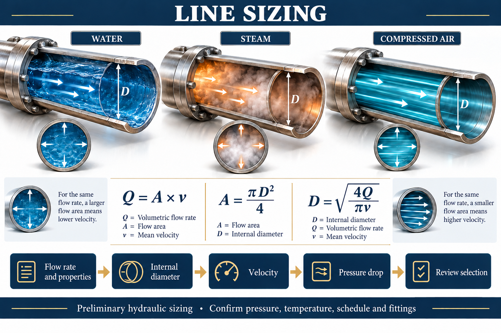
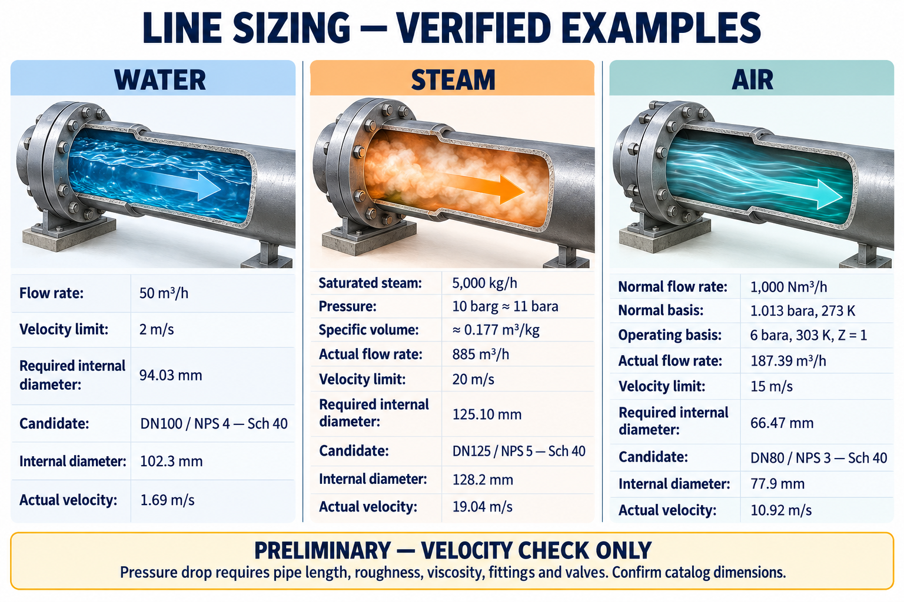

# Process Line Sizing

An agent skill and dependency-free Node.js calculator for preliminary single-phase **Water, Gas and Steam** line sizing. Main instructions are in English; Portuguese and Spanish translations retain English technical nomenclature.

[English skill](SKILL.md) · [Português](SKILL.pt-BR.md) · [Español](SKILL.es.md)



## What it does

- Converts Normal flow rate to Actual flow rate using explicit Absolute pressure, Temperature and Compressibility factor.
- Calculates Minimum internal diameter from a supplied Velocity limit.
- Evaluates supplied pipe candidates using actual Internal diameter rather than DN/NPS alone.
- Screens Pressure drop using Darcy–Weisbach when all required hydraulic inputs are present.
- Asks for missing Pressure drop inputs before continuing hydraulic acceptance.

**Missing Pressure drop data means PRELIMINARY — VELOCITY CHECK ONLY.** The skill requests Allowable pressure drop, Pipe length, Internal diameter/Pipe schedule, Density, Dynamic viscosity, Roughness, and fitting/valve Loss coefficients as needed. It does not invent a pressure budget or assume absent losses are zero.

## Verified examples



The Steam example uses Specific volume ≈ 0.177 m³/kg at 10 barg: 5,000 kg/h gives 885 m³/h and Minimum internal diameter ≈ 125.10 mm at 20 m/s. DN125 Sch40 with Internal diameter 128.2 mm passes this Velocity criterion; Pressure drop remains unverified. Approximate Air operating pressure is explicitly 6 bara.

See the [independent verification and sources](docs/verification.md) and [method/input schema](references/method.md). Catalog dimensions are illustrative and must be confirmed for the actual pipe specification.

## Use

Requires Node.js. No npm dependencies.

```sh
node scripts/line-sizing.cjs --self-test
node scripts/line-sizing.cjs examples/water-velocity.json
```

For Codex, copy this repository into your personal skills directory as `process-line-sizing`, then invoke `$process-line-sizing`. Keep `SKILL.md`, translations, scripts, references and assets together.

## Scope

Hydraulic screening is not mechanical code certification or final design approval. The calculator uses constant Density for friction/local losses. Gas/Steam results require a suitable Compressible flow model where property variation matters. Static head, NPSH, Flashing, Water hammer, wet/two-phase flow, heat loss and mechanical verification require separate analysis. Velocity limits are supplied project criteria, not universal ASME B31.3 or API 610 requirements.

Images were generated with AI and checked against the documented rounded examples. The executable calculations and source-backed assumptions are the numerical reference.
